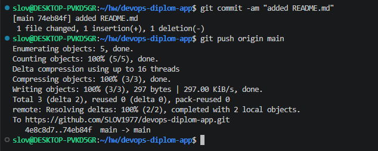
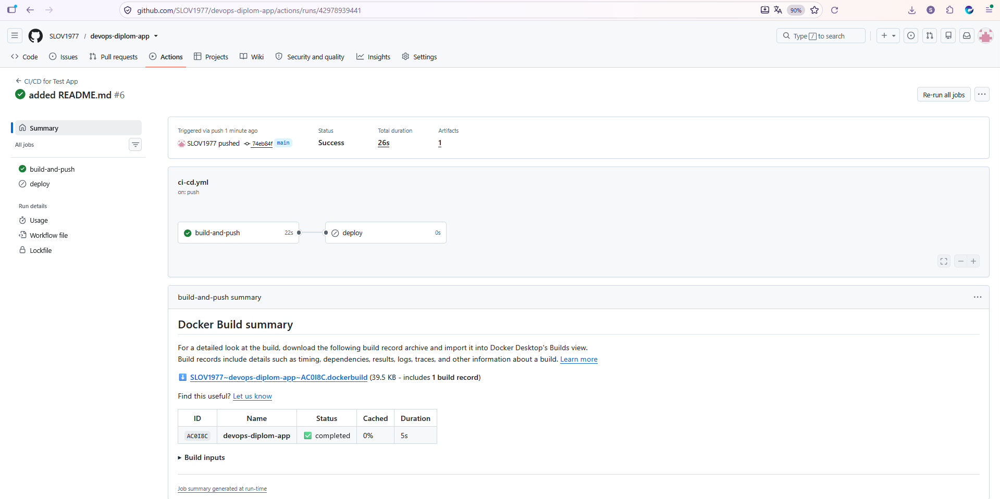
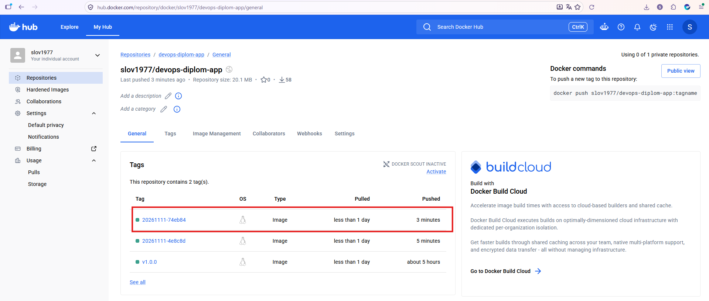
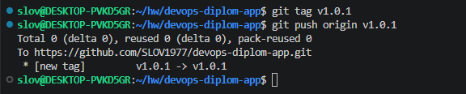
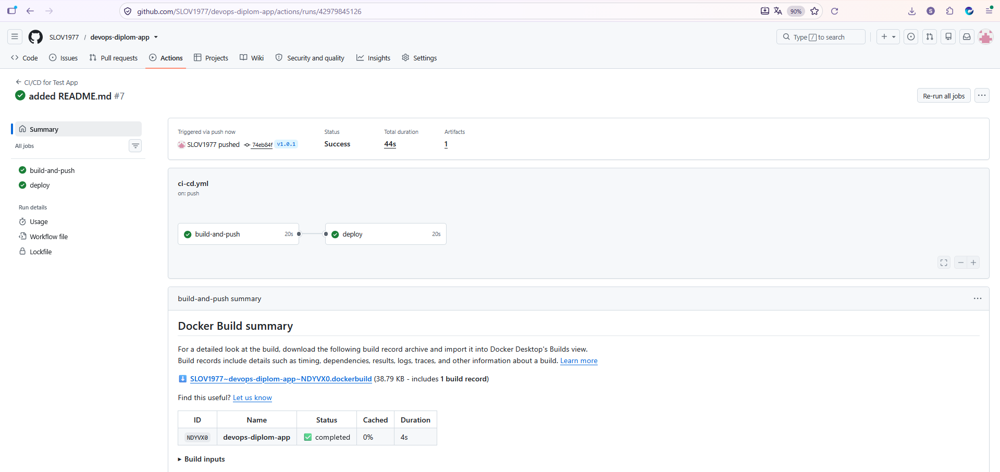
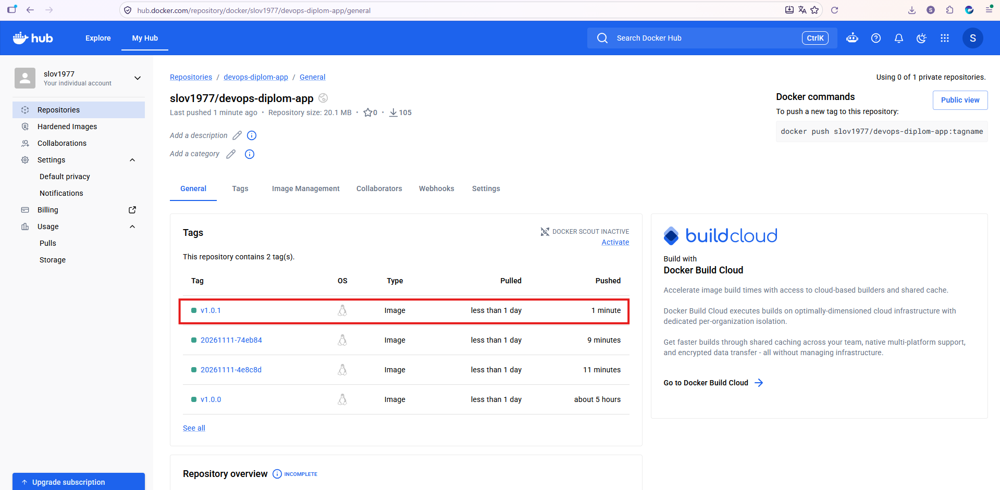
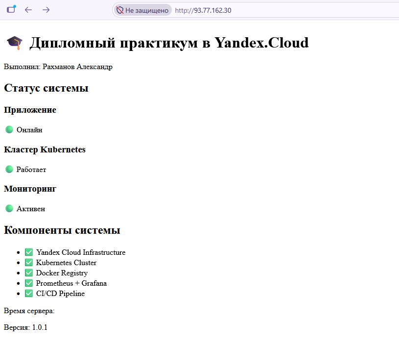
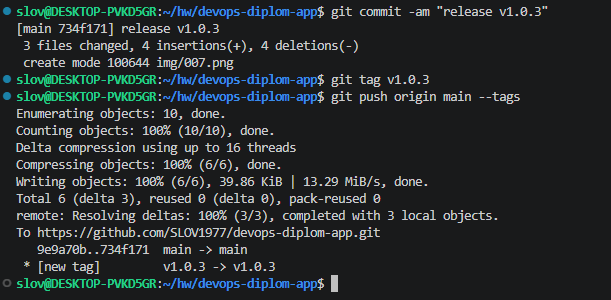
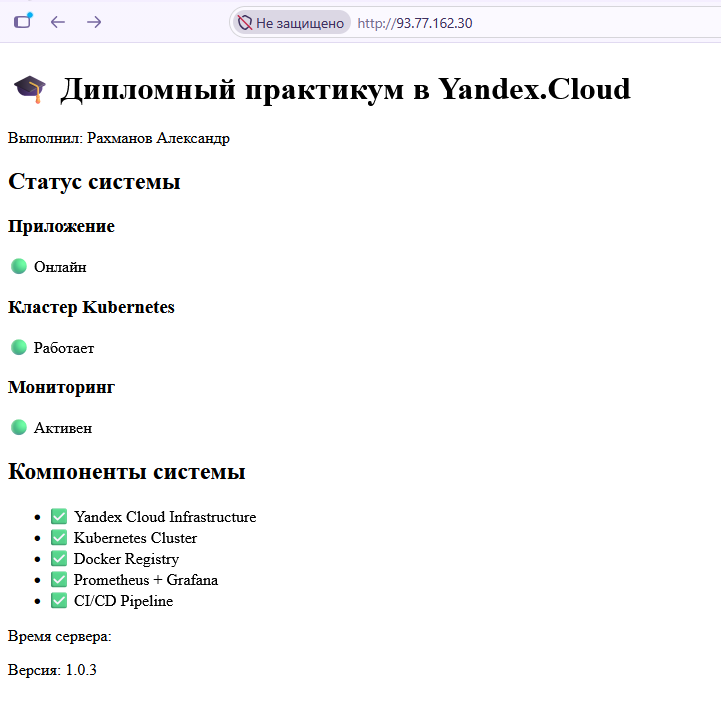

# `devops-diplom-app` - `Рахманов Александр`  

Тестовое приложение содержит статичную `HTML-страницу` и `Dockerfile` с nginx, который будет отдавать статические данные html-страницы.  

**GitHub Actions.**  

В файле [ci-cd.yaml](https://github.com/SLOV1977/devops-diplom-app/tree/main/.github/workflows/ci-cd.yaml) настроено:  
- При любом коммите в репозиторий с тестовым приложением происходит сборка и отправка в регистр Docker образа.  
- При создании тега (например, v1.0.0) происходит сборка и отправка с соответствующим label в регистри, а также деплой соответствующего Docker образа в кластер Kubernetes.

### Как это работает:  

**1.** Коммит в ветку main (без тега):  

```
git commit -am "added README.md"
git push origin main
```




Запускается только `build-and-push`  




Образ помечается как `slov1977/devops-diplom-app:20261111-abc123`  




`deploy` - НЕ запускается  

**2.** Создание тега:  

```
git tag v1.0.1
git push origin v1.0.1
```




Запускаются обе jobs: `build-and-push` и `deploy`  




Образ помечается как `slov1977/devops-diplom-app:v1.0.1`  




Приложение деплоится в кластер `Kubernetes`  




**3.** Коммит с тегом (альтернативный способ):  

```
git commit -am "release v1.0.3"
git tag v1.0.3
git push origin main --tags
```




Пуш `git push origin main --tags` создаёт два отдельных запуска `workflow`:  

1. При пуше в `main` запустится `build-and-push` с SHA-тегом  

2. При пуше тега v1.0.3 запустится `build-and-push` и `deploy` с версионным тегом  



